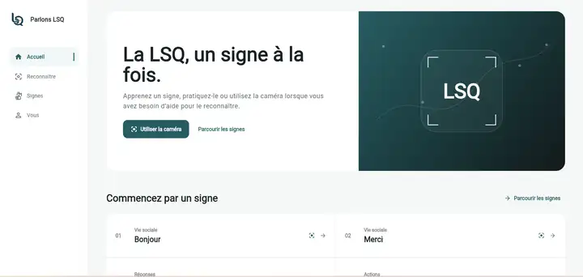
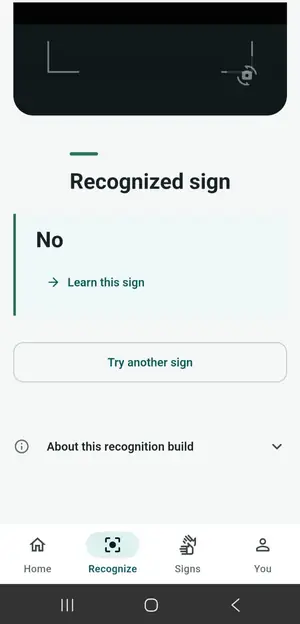
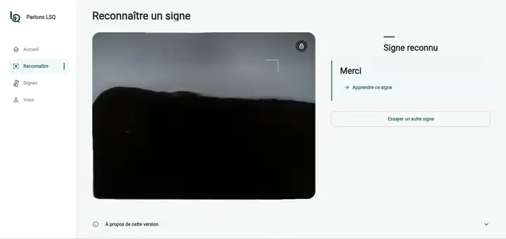
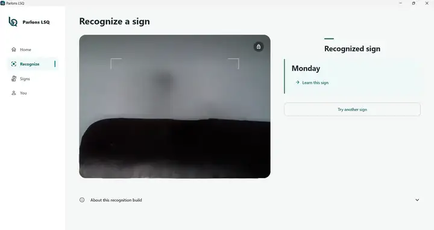
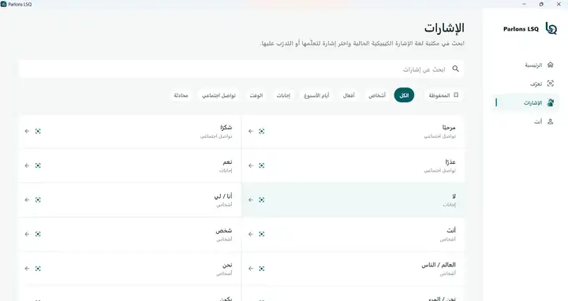

# Parlons LSQ

**Computer-vision research for isolated Québec Sign Language (LSQ) recognition.**

Parlons LSQ is an experimental sign-recognition project spanning data collection, temporal modeling, and cross-platform inference. Its first frozen runtime, **v1.5**, recognizes 29 isolated signs from landmark sequences and was demonstrated on Android, Web, and Windows.



## Project overview

The initial model was developed from collected isolated-sign samples rather than an end-to-end pretrained sign-language recognizer. Camera observations are converted into a fixed representation, resampled over time, and classified by a compact neural network.

```text
Video / camera input
       ↓
MediaPipe landmarks
       ↓
228 features per step
       ↓
64-step temporal sequence
       ↓
29-class classifier
       ↓
Recognition result
```

| Property | Runtime v1.5 |
| --- | --- |
| Task | Isolated-sign classification |
| Vocabulary | 29 signs |
| Input | 64 × 228 |
| Feature schema | `legacy-mediapipe-228-v1` |
| Model identity | `prototype-lsq-29-v1` |
| Inference | Local on Android, Web, and Windows |
| Interface languages | French, English, Arabic (RTL) |

The model is a **closed-vocabulary prototype**, not a continuous LSQ-to-text translation system. Its raw classifier scores are not calibrated confidence estimates.

## Demonstrations

| Android recognition | Web recognition |
| --- | --- |
|  |  |

| Windows recognition | Arabic right-to-left interface |
| --- | --- |
|  |  |

The Android result includes a qualitative check using external reference footage. Web and Windows camera previews were privacy-redacted after capture. The underlying footage is not distributed here.

## Engineering

Runtime v1.5 uses the same model input contract across platform-specific inference paths:

| Platform | Local inference path |
| --- | --- |
| Android | MediaPipe Tasks → LiteRT/TFLite |
| Web | MediaPipe Tasks WASM → LiteRT.js |
| Windows | Local Python worker → OpenCV / MediaPipe → H5 model |

The application also includes learning content and localized interfaces. Recognition video is processed locally in the documented runtime; the learning-content service is a separate component.

See [Architecture](ARCHITECTURE.md) for preprocessing, runtime boundaries, and application design.

## Results and limitations

Development testing showed successful recognition in familiar capture conditions and qualitative successes on examples outside the original collection. Recognition was less reliable when signing speed, lighting, framing, distance, or camera position varied.

These observations motivated the next research direction: broader data collection, independent signers and sessions, and more robust visual-temporal models.

**No population-level accuracy, signer-independent benchmark, or continuous-signing performance is claimed.** The observations and evidence boundaries are documented in [Evaluation](EVIDENCE.md).

## Repository scope

This repository is a **public technical showcase**, not the application source distribution. It contains documentation, selected screenshots, a frozen model identity, and release provenance. The Frontend, Backend, and Research repositories remain private.

The snapshot represented here is `v1.0.0-showcase` for Runtime v1.5. Exact source revisions, model checksum, and screenshot hashes are recorded in [Build manifest](BUILD_MANIFEST.md). To verify the public artifact manifest:

```sh
python scripts/validate_showcase.py
```

For the strict publication check, see [Release process](RELEASES.md).

## Documentation

- [Architecture](ARCHITECTURE.md) — model contract and platform runtimes
- [Evaluation](EVIDENCE.md) — observations, evidence, and limitations
- [Research direction](RESEARCH.md) — work beyond the frozen baseline
- [Privacy](PRIVACY.md) — local processing and data boundaries
- [Build manifest](BUILD_MANIFEST.md) — source and artifact provenance
- [Source access](ACCESS.md) — private implementation review

## License and access

Copyright © 2026 Anes. All rights reserved.

The showcase is publicly viewable but is **not an open-source distribution**. See [LICENSE](LICENSE) for permitted use. Reviewers and potential collaborators may contact [@anes-dev-ml](https://github.com/anes-dev-ml) about case-by-case access to private implementation material.
